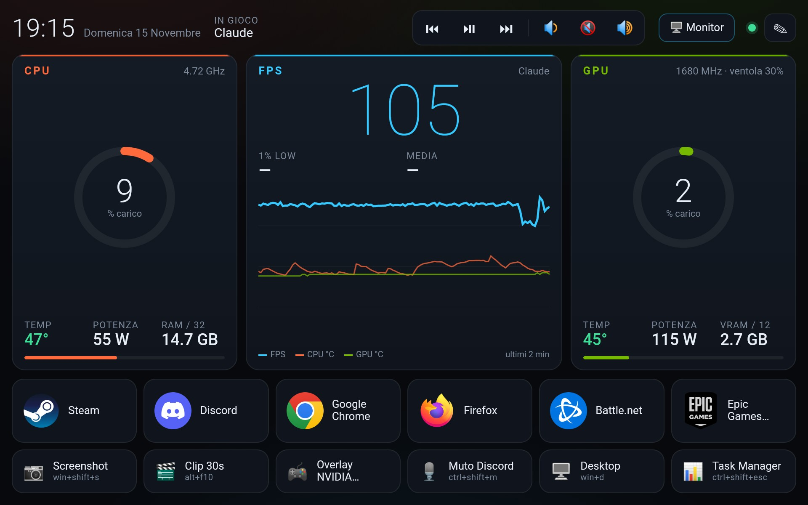
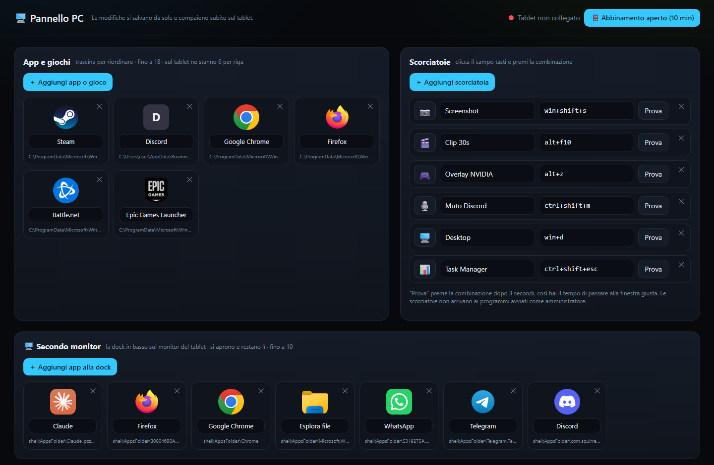

# 🧬 SymbioDeck — an old Android tablet in symbiosis with your gaming PC

*Live control deck and one-tap second monitor that sleeps and wakes together with the PC.*

   

Settings page on the PC (apps, shortcuts, second-monitor dock, tablet pairing)

**An always-on companion screen with live temperatures, FPS, CPU/GPU load, app launchers, custom hotkeys and media
controls, plus a one-tap second monitor.** Built to give a slow, forgotten tablet a real job next to the PC.

### Highlights
- 📊 **Live telemetry once per second**: CPU/GPU temperature, load, power, clocks, RAM/VRAM and **in-game FPS with 1% lows**, read straight from MSI Afterburner / RivaTuner shared memory (falls back to `psutil` + `nvidia-smi` when Afterburner isn't running)
- 🚀 **Launchers and hotkeys you can swap in seconds**: drag-and-drop editor on the PC, Start-menu, Steam library and Microsoft Store apps detected automatically, hotkeys recorded by pressing them
- 🖥️ **Second monitor in one tap**: opens an [Apollo](https://github.com/ClassicOldSong/Apollo) virtual display through Artemis, with a dock of chosen apps that open and stay maximised on the tablet's screen; touching the tablet while a fullscreen game runs no longer takes the controls away from the game (focus and cursor go back to it once the touch ends)
- 🔗 **"Symbiosis" with the PC**: the tablet's screen turns off when the PC sleeps or shuts down and turns back on when it wakes (Windows power events, plus a silent-stream watchdog for sleeps Windows doesn't announce)
- 📲 **Zero-config pairing**: the tablet finds the PC on its own over Wi-Fi (UDP broadcast) or USB (`adb reverse`); the access key is shared only in a 10-minute pairing window
- 🔒 Local network only, token-protected API, separate PC-only key for the settings page
- 🪶 Lightweight by design: Python standard library on the PC, a vanilla HTML/JS page, and a tiny Android app built **without Gradle** (aapt2 + javac + d8)

### Try it
1. **PC (Windows 10/11)**: download this repo, right-click `installa.ps1` → *Run with PowerShell*. It installs the
   only dependency, sets the server to start at login and opens the settings page. No admin rights needed.
   Optional: [MSI Afterburner](https://www.msi.com/Landing/afterburner) for FPS and CPU temperature.
2. **Tablet (Android 8+)**: install `PannelloPC.apk` from the
   [latest release](https://github.com/rikyroky91-commits/symbiodeck/releases/latest) and open it. It finds the PC by
   itself. To pair another tablet later: settings → **📲 Abbina un tablet**.
3. Optional extras: [Apollo](https://github.com/ClassicOldSong/Apollo) on the PC and Artemis on the tablet for the
   second monitor; root/system-app install for the full power-management features (see `LEGGIMI.md`).

> The interface is currently in Italian.

### Tech
Python (`http.server`, `ctypes` Win32: shared memory, power events, `keybd_event`, AppBar) · Server-Sent Events ·
vanilla JS / CSS · Java Android app (WebView, DevicePolicyManager, UDP discovery) · PowerShell · Apollo / Artemis

---

## 🇮🇹 In breve

**SymbioDeck** (l'app si chiama ancora *Pannello PC*): un vecchio tablet Android diventa il pannello sempre acceso del PC da gioco: temperature, FPS, carico di CPU e GPU,
app e scorciatoie personalizzabili, controlli multimediali e **secondo monitor con un tocco**. Si spegne e si
riaccende insieme al PC. Per provarlo: sul PC `installa.ps1`, sul tablet l'APK dalle
[Release](https://github.com/rikyroky91-commits/symbiodeck/releases/latest); il tablet trova il PC da solo.
La documentazione tecnica completa (in italiano) è in [LEGGIMI.md](LEGGIMI.md).
